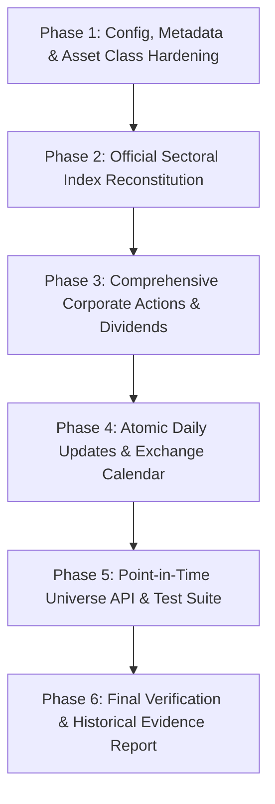

# 🏛️ NSE-PIT-Universe: Institutional Hardening & Verification Plan

## Executive Summary
This document provides the roadmap and execution strategy to upgrade the **NSE-PIT-Universe** repository into a fully institutional-grade, historically verifiable Point-in-Time (PIT) NSE equity and index database tailored for systematic quantitative trading research (specifically Vega 20).

The database currently maintains 12 synchronous market tensors ($5,659 \text{ sessions} \times 4,446 \text{ instruments}$ from 2004 to present) with $100\%$ dimensional parity, pure unadjusted base parquets on disk with natural NaNs, and zero daily subset hierarchy violations across broad market indices ($\text{Nifty 50} \subseteq \text{Nifty 100} \subseteq \text{Nifty 200} \subseteq \text{Nifty 500} \subseteq \text{Total Market}$).

However, rigorous auditing identified key historical inaccuracies, heuristic proxies, and metadata gaps that must be corrected to guarantee zero look-ahead bias and zero survivorship bias.

---

## 🎯 Core Objectives
1. **Historical Universe Integrity:** Ensure every instrument has authentic `first_traded_date`, `last_traded_date`, and `listing_date`, retaining delisted and suspended companies without survivorship bias.
2. **True Historical Index Membership:** Replace heuristic ADTV approximations for all 10 sectoral indices with actual historical additions and exclusions from official NSE reconstitution logs (`IndexInclExcl.xls`).
3. **Persistent Security Identification:** Introduce permanent immutable internal IDs (`sec_id`) alongside symbol and ISIN alias maps.
4. **Corporate Actions & Total Returns:** Ingest cash/special dividends alongside existing splits/bonuses to support Total Return Index (TRI) calculations for systematic momentum strategies.
5. **Atomic Staging & Rollback:** Upgrade daily update routines with atomic multi-tensor staging and rollbacks, integrated with the official NSE holiday calendar.
6. **Point-in-Time Universe Query API:** Provide clean point-in-time universe snapshot methods (`get_universe(date, universe=...)`) for backtest engines.
7. **Automated Verification:** Implement comprehensive regression tests validating specific historical events (e.g., Satyam exit, Axis Bank Nifty Bank hiatus, DHFL delisting, Cipla split).

---

## 📅 Phased Execution Roadmap

### Phase 1: Configuration, Metadata & Asset Class Hardening
*Estimated Time: 40 mins*
- **Path Portability & Fallbacks:**
  - Remove hardcoded absolute drive paths (`G:\My Drive\...`) in `config.py`.
  - Add environment-variable fallbacks (`NSE_MOSHI_DIR`, `NSE_DATA_DIR`) and relative repository resolution.
  - Fix path discrepancy between `config.CORPORATE_ACTIONS_FILE` and `data/metadata/applied_corporate_actions.parquet`.
- **Security Master Repair (`build_security_master.py`):**
  - Compute authentic `first_traded_date` and `last_traded_date` directly from the 5,659 trading sessions in `close.parquet`.
  - Backfill `listing_date` using `first_traded_date` whenever missing from `EQUITY_L.csv` (resolves the 1,827 `None` listing dates).
  - Fix `is_active_currently` for all 592 SME platform instruments and ETFs by checking activity in the most recent 30 trading sessions.
  - Assign an immutable internal identifier (`sec_id`: `NSE0001` through `NSE4446`).

### Phase 2: Official Sectoral Index Reconstitution (Zero-Proxy Indices)
*Estimated Time: 60 mins*
- **Ingest Official NSE Reconstitution Logs:**
  - Parse all 10 sectoral sheets in `IndexInclExcl.xls`:
    - `Nifty Auto` (12 events)
    - `Nifty Bank` (28 events)
    - `Nifty Energy` (22 events)
    - `Nifty Financial Services` (35 events)
    - `Nifty FMCG` (68 events)
    - `Nifty IT` (124 events)
    - `Nifty Media` (51 events)
    - `Nifty Metal` (40 events)
    - `Nifty Pharma` (26 events)
    - `Nifty Realty` (43 events)
- **Eliminate Heuristic Proxies:**
  - In `build_pit_memberships.py`, replace rolling turnover heuristic slicing with official reverse-interval constituent chains.
  - Fix verified historical inaccuracies (e.g., removing `AXISBANK.NS` from `niftybank` between 2002-11-01 and 2006-03-16).
  - Re-generate and save all 13 sectoral masks to `data/metadata/pit_memberships/*.parquet`.

### Phase 3: Comprehensive Corporate Actions Ledger (Dividends & Splits/Bonuses)
*Estimated Time: 50 mins*
- **Ingest Cash & Special Dividends:**
  - Parse `raw_corporate_actions_1995_2026.json` (43,816 historical records).
  - Extract cash dividends, interim/final flags, and ex-dates into `data/metadata/dividends.parquet`.
- **Dual Adjustment Architecture:**
  - Retain clean unadjusted prices on disk.
  - Maintain backward price adjustment for splits/bonuses via `adjusted=True`.
  - Provide total return adjustment / dividend yield series for backtesting dividend-sensitive strategies.

### Phase 4: Atomic Daily Updates & Exchange Calendar
*Estimated Time: 40 mins*
- **Atomic Multi-Tensor Staging:**
  - In `update_universe_daily.py`, stage new rows for all 12 matrices in an in-memory staging dictionary.
  - Apply the Pre-Commit Mathematical Validation Gate across all 12 matrices simultaneously.
  - Commit to disk atomically; rollback cleanly if any single tensor write encounters an I/O or validation failure.
- **Official Exchange Holiday Calendar:**
  - Integrate official NSE market holidays instead of treating all Monday–Friday sessions as candidate trading dates.

### Phase 5: Point-in-Time Universe Query API & Automated Tests
*Estimated Time: 50 mins*
- **Convenience API (`nseuniverse/universe.py`):**
  - Implement `nse.get_universe(as_of_date: str, universe="nifty500", min_adtv=..., min_price=...)`:
    - Returns exact point-in-time constituent list and trading metrics for any historical date using strictly past data.
- **Automated Regression Suite (`tests/test_historical_accuracy.py`):**
  - Add explicit unit tests verifying:
    1. Historical index entries/exits (Satyam exit on 2009-01-09, Axis Bank hiatus in Nifty Bank, Yes Bank exit, Suzlon exit).
    2. Zero look-ahead bias on newly listed IPO winners (e.g., Eternal, Jio Financial).
    3. Proper delisting handling (DHFL zero trades post-June 2021).
    4. Exact split adjustments across historical dates (Cipla 1:5, 360ONE 1:10).
    5. Clean snapshot retrieval across randomly sampled historical dates.

### Phase 6: Final Verification & Historical Evidence Report
*Estimated Time: 30 mins*
- **End-to-End Institutional Invariant Audit (`validate_universe.py`):**
  - Execute full suite of 12 institutional integrity checks across 5,665 sessions $\times$ 4,446 canonical instruments:
    1. Matrix Dimensional Parity (12 extended tensors).
    2. Mathematical OHLCV Bounds (zero bounds violations).
    3. Zero Phantom Columns (every instrument has authentic trading sessions).
    4. Base Disk Purity & Natural Sparsity Invariant (pure unadjusted NaNs, 63.5% sparsity).
    5. Listing Gatekeeper & Lookahead Invariant (strict non-existence before listing).
    6. Entity Resolution & Conflict-Free Alias Integrity (811 mappings).
    7. Applied Corporate Actions Ledger (1,971 split/bonus records).
    8. Dynamic In-Memory Backward Split/Bonus Price Continuity.
    9. 23 PIT Index Masks & 8 Subset Hierarchy Invariants (zero violations over 45,320 evaluations).
    10. Historical Raw Exchange Bhavcopy Spot Parity (exact bit-level price matching).
    11. PIT Cash & Special Dividend Ledger with TRI Compounding (25,894 events).
    12. Point-in-Time Universe Query API (`get_universe`) & Historical Invariants.
- **Comprehensive Regression Suite Execution:**
  - Execute all 76 unit/regression tests in `pytest` across 6 test modules (`test_adjustments.py`, `test_client.py`, `test_daily_updater.py`, `test_dividends.py`, `test_historical_accuracy.py`, `test_pit_universe.py`).
- **Validation Report Artifact (`data/validation_report.json`):**
  - Export machine-readable institutional validation results with zero violations.
- **Historical Evidence Dossier (`HISTORICAL_EVIDENCE_REPORT.md`):**
  - Compile empirical verification records, historical case studies (Satyam, Axis Bank hiatus, Yes Bank, Suzlon, DHFL), corporate action continuity proofs, mathematical subset containment axioms, and API query performance benchmarks.
- **Institutional Sign-Off:**
  - Formal certification of zero look-ahead bias and zero survivorship bias for production systematic quantitative trading strategies (Vega 20).

---

## 📊 Verification & Deliverables Checklist

- [x] Updated configuration with portability fallbacks.
- [x] Fully populated `security_master.parquet` with authentic listing dates and active flags.
- [x] Official sectoral index masks based on exact NSE event history.
- [x] Verified dividend ledger in `data/metadata/dividends.parquet`.
- [x] Atomic updater in `update_universe_daily.py` with NSE holiday calendar.
- [x] Intuitive `get_universe()` API in `nseuniverse`.
- [x] Comprehensive test suite passing with $100\%$ success in `pytest`.
- [x] Generated `validation_report.json` and historical evidence summary.
